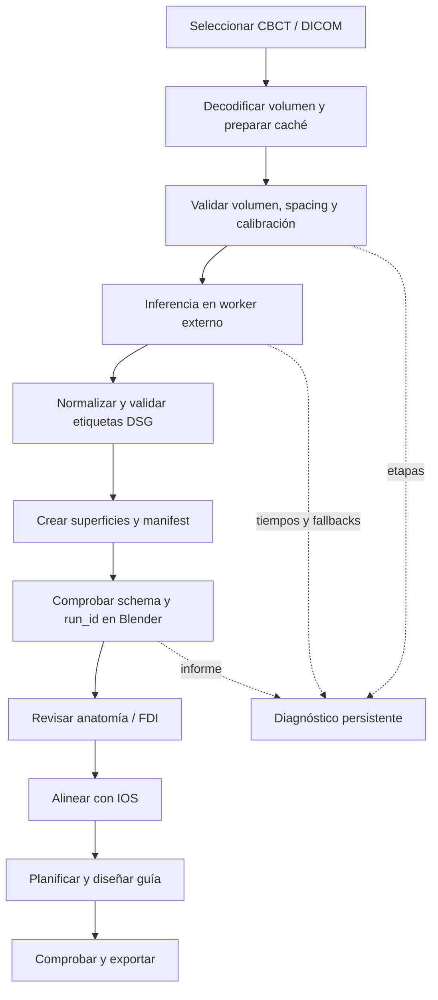

# Cómo funciona DSG 9.10.11

## Procesos y responsabilidades

Blender mantiene interfaz, operadores, escena, historial e importación de mallas. La inferencia neuronal se ejecuta en un worker externo con el runtime IA. Otros workers preparan motores, comprueban el entorno o calculan el suavizado. Esto reduce el trabajo pesado directo en el hilo de la interfaz.

`core.py` coordina la ruta; DICOM prepara el volumen; `cbct_pipeline_client.py` crea y consulta la ejecución; `cbct_pipeline_worker.py` procesa la petición; `cbct_dental_module.py` prepara la dentición. Después actúan alineación y guía.

## Rutas distintas

| Ruta | Resultado |
|---|---|
| Implante simple / `SIMPLE_ARCHES` | Dos arcadas para revisión y alineación; tiene su propia traducción y procesamiento |
| Implante inmediato / `IMMEDIATE` | Dientes individuales/FDI y anatomía requerida para extracción: maxilares y canal; necesita motor compatible y revisión |

ToothSeg devuelve dientes/FDI y no maxilares/canal. La interfaz bloquea su uso cuando la ruta requiere esas salidas. Los labels 1–32 representan dientes compatibles; 53, 54 y 55 están reservados para mandíbula, maxila y canal, y no se convierten a FDI.

## Contratos de entrada y salida

El worker valida volumen, espaciado y metadatos de calibración. Después valida dimensiones, dtype y etiquetas del labelmap. Publica un manifest operativo con `schema_version=1` y `run_id`. Blender exige el identificador esperado antes de importar resultados: encontrar archivos temporales no equivale a éxito.

Las validaciones no convierten todos los CBCT a una escala HU universal. Un error mantiene la etapa y una causa accionable.

## Diagnóstico y recuperación

En `scripts/dsg_diagnostics`, dentro de los recursos de usuario de Blender 5.2, se conserva un informe de identificador, versión, motor, etapas, duración, estado y fallbacks. **Copiar diagnóstico** recupera ese registro tras limpiar los temporales. No copia peticiones privadas ni logs libres; el manifest operativo con rutas de geometría permanece separado.

Si el lanzamiento directo falla existe un fallback a Blender en segundo plano. Los caminos de inferencia que lo implementan pueden reintentar CPU tras un fallo CUDA. El diagnóstico registra esas decisiones; cambiar de dispositivo no resuelve por sí solo pesos ausentes o una entrada inválida.

## Suavizado e historial

El suavizado usa worker y caché; conserva originales para restauración y alineación numérica. Si cambian identidad o transformaciones durante el cálculo, descarta el lote antes de aplicarlo.

Ctrl+Z combina el deshacer nativo con checkpoints archivados de escena y estado del pipeline. Evita repetir la inferencia. Escribir un STL o instalar dependencias son efectos externos que permanecen en disco.

Los módulos de DICOM, alineación y guía aún cargan fragmentos en un espacio de nombres compartido. El núcleo nuevo no elimina esa deuda ni todos los estados globales. El [mapa](../dsg/docs/CODEMAP.md) describe el código actual; la [hoja de ruta](FUTURAS_MEJORAS.md) propone migraciones graduales.
